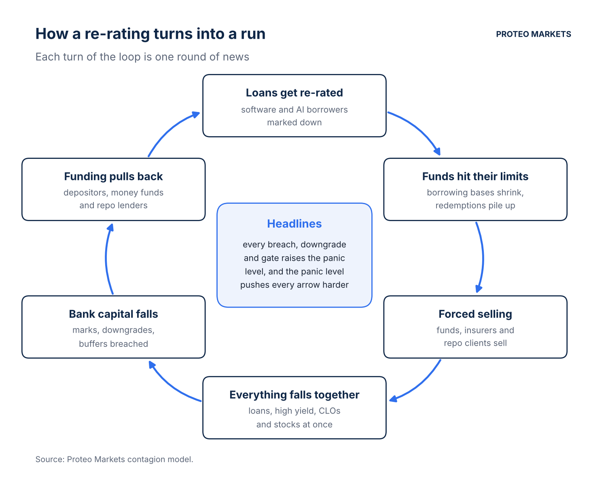
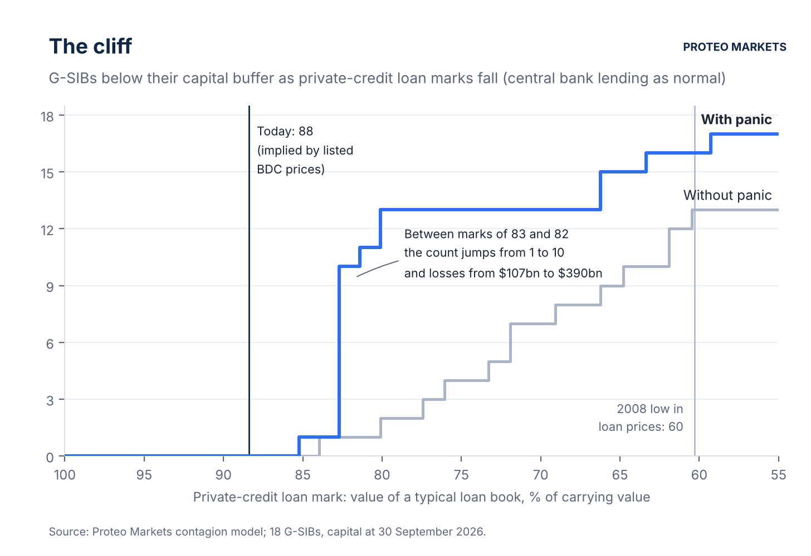
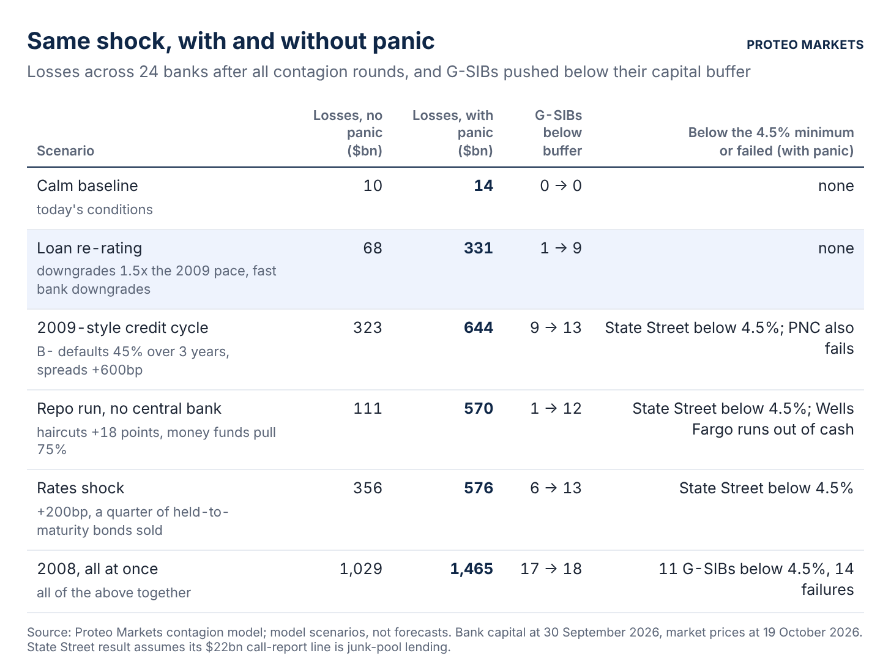
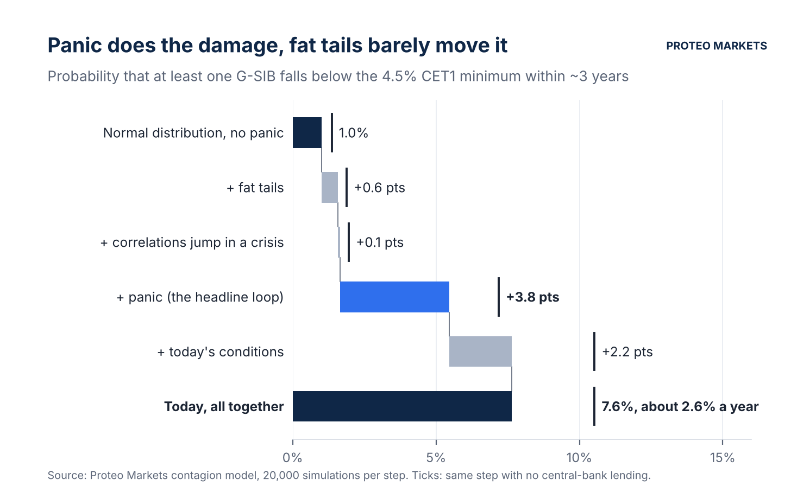
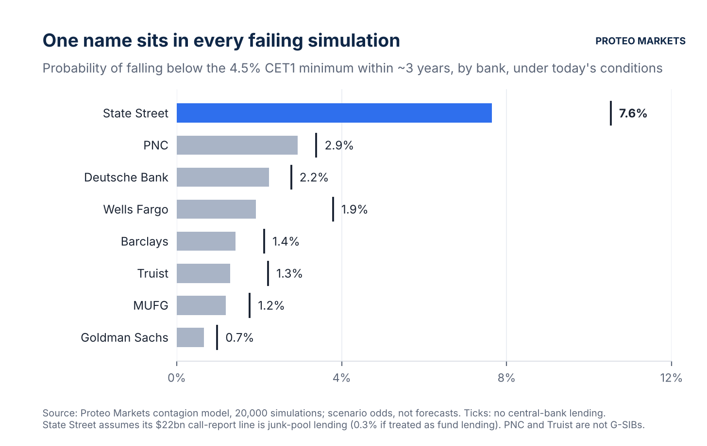
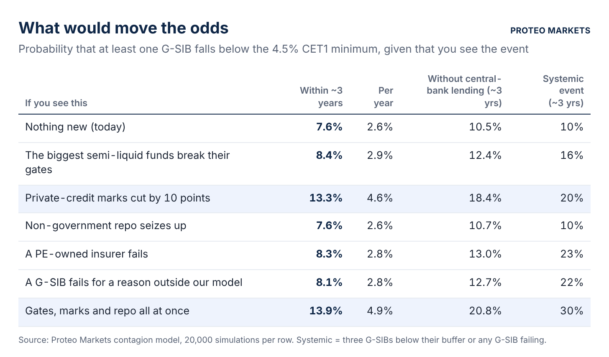
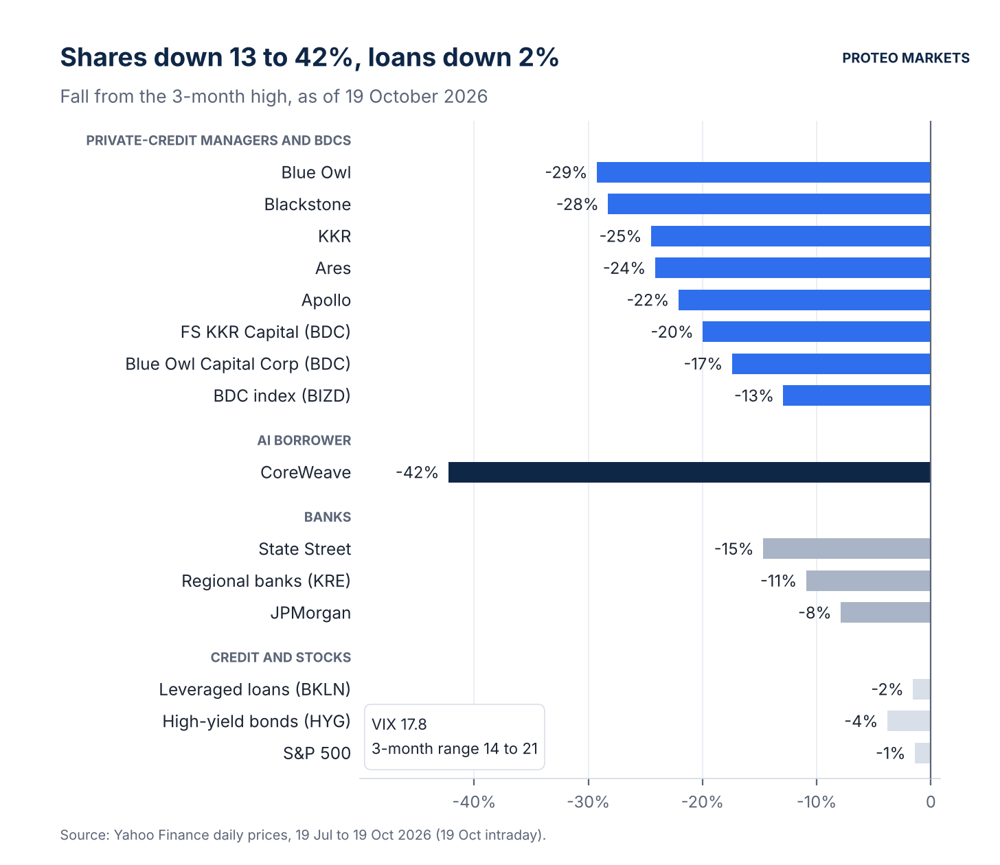

# The Six-Point Cliff

*We modelled how a private-credit scare would reach the banks. The bad loans did less damage than the headlines about them, and on today's prices the tipping point is about six points away.*

Claude and I ran through this over the weekend.

**TL;DR**

- Banks hold little private credit directly. They lend to the lenders. At mid-year US banks had $856bn of loans out to non-bank lenders and PE funds, plus $489bn more committed but undrawn.
- Taken one channel at a time, none of the usual worries (a software repricing, GPUs losing value, a wave of downgrades, a repo run) pushes a large bank below its capital buffer.
- Add panic, where every downgrade and fund gate becomes a headline that makes everyone sell at once, and the damage stops building gradually. Between loan marks of 83 and 82, the number of G-SIBs below their buffers jumps from one to ten.
- Listed BDC prices put private-credit loans at about 88 today, six points from the edge and three closer than when we first ran this on 8 October.
- Odds that a G-SIB drops below the 4.5% legal minimum within three years: 7.6%, or 2.6% a year. Nearly all of it is State Street, mostly because of a conservative assumption of ours.

**Our view**

- A G-SIB breaching its legal minimum is more likely than the 1% a textbook model gives, but we don't think it's imminent.
- Watch the marks. A 10-point cut in private-credit valuations takes the odds to 13%.
- So far the stress is in the shares: managers and BDCs are down 13 to 29% from their highs. Loans and high-yield bonds are within 2 to 4% of theirs.

---

It started in our group chat. Most of us, me included, were 99% sure a bank was about to fail because of private credit. The argument went like this: loans get re-rated, word gets out, and everyone heads for the door at the same moment. Every correlation goes to 1, and a problem the size of a few funds becomes a problem the size of the banking system.

Nobody had a number, so we built a model.

## Who lends to the lenders

Private credit is the $1.7 to 2 trillion of loans that funds make directly to companies, mostly mid-sized businesses owned by private equity. Banks mostly come in one step back, as lenders to those funds.

A fund buys loans, pledges them to a bank and borrows 50 to 75 cents against every dollar. Banks also lend to the PE funds themselves, against money their investors have promised but not yet paid in. At 30 June, US call reports showed $856bn of loans to non-bank lenders and PE funds drawn, and another $489bn committed. That's 45% of the reporting banks' CET1 capital, 71% if every line were drawn. Last week's third-quarter numbers look much the same: Wells Fargo has $201bn out to "financials except banks", Bank of America $168bn to asset managers and funds.

Software is the weak spot. About a fifth of BDC portfolios, $73bn of $369bn, is lent to software companies, the ones investors now fear AI will eat. Distressed software loans trade at 50 to 65 cents. JPMorgan marked down software collateral in March, and the New York Fed has been visiting JPMorgan, Wells Fargo, Morgan Stanley and Barclays since spring to ask about all of this ([Semafor](https://www.semafor.com/article/10/05/2026/private-credit-worries-spur-fed-review)).

Still, the bank sits at the top of the stack. If it lends 70 cents against a pool of loans, the pool has to lose 30% before the bank loses anything, and a software repricing alone doesn't get there.

## One risk at a time

We put 24 banks into a model: 13 American banks, 10 from Europe, Japan and Canada, plus Jefferies. Then we stressed them one risk at a time: private-credit lending, fund finance, structured lending, loans to PE-owned insurers, AI and GPU lending, trading books, commercial property, rate losses, lost risk-transfer relief and prime brokerage.

At the severity of today's worries, no single channel pushed a G-SIB below its capital buffer. The worst hit was Morgan Stanley, which lost just over a point of its CET1 ratio when we let GPUs lose value fast. Buffers start to give when several things go wrong together. A 2009-sized credit cycle puts nine G-SIBs below them, and even then no bank goes below the legal minimum.

Then we ran it backwards and asked how far private-credit loans have to fall before things break. Without any panic, three G-SIBs slip below their buffers when loans are worth 77 cents on the dollar. The first bank goes below the 4.5% legal minimum at 61, almost exactly the 2008 low in leveraged-loan prices.

## Adding panic

On 9 March 2023, depositors pulled $42bn out of Silicon Valley Bank in a day. The panic spread through venture-capital group chats and Twitter, and a later study by [Cookson and co-authors](https://papers.ssrn.com/abstract=4422754) found that banks with more Twitter exposure going in lost 4.3 percentage points more of their stock market value during the run. Three years earlier, in March 2020, the leveraged-loan index fell to 76 in a few weeks and nearly everything fell with it, Treasuries included for a few days.

That's the mechanism our group chat was arguing about, and our first model had none of it. Every bank reacted to its own losses and nothing else.

So we added a panic dial that runs from 0 (calm) to 1 (full panic). After every round of losses the market reads the news: a fund breaching its asset-coverage limit, the discount on private-credit loans, bank downgrades, a G-SIB dropping below its buffer, any failure. The dial moves, and then it pushes on everything at once. Credit losses deepen and spreads widen. Funds have to mark loans at market prices, and redemption requests jump. Depositors leave the six weakest banks, money funds and repo lenders pull back, and every risky asset class takes the same panic discount. That common discount is how the model sends correlations to 1.

## The cliff

We ran the backwards test again with the dial switched on.

Without panic the damage builds slowly, roughly one more bank in trouble for every two points the loans lose. With panic, nothing happens for a long stretch. Then, between marks of 83 and 82, the count of G-SIBs below their buffers jumps from 1 to 10, and losses across the 24 banks go from $107bn to $390bn on a one-point move.

Listed BDCs trade below the value of their loans, so you can back out what the market thinks those loans are worth. Today that's about 88, six points from the edge. On 8 October the market was at 89 and the edge between 82 and 80, so the gap has shrunk by about three points in eleven days.

## What changed in eleven days

We first ran all of this on 8 October. In our loan re-rating scenario (downgrades at 1.5 times the 2009 pace, banks cut quickly) the market got nervous and then calmed down. The panic dial climbed to 0.22 and stopped there. Losses were $98bn and no G-SIB went below its buffer.

Then the banks reported their third quarter. Goldman Sachs's CET1 ratio slipped from 12.9% to 12.4% as its risk-weighted assets grew to $817bn, and Bank of America's went from 11.3% to 10.9%. Neither looked like much at the time.

We ran the same scenario with the new capital figures. This time Goldman finishes the re-rating 7 basis points under its 11.4% requirement, before any panic at all. In real life that just means limits on dividends and buybacks; in the model it's a headline. The dial goes 0.21, then 0.52, then 0.98. Nine G-SIBs end up below their buffers and losses reach $331bn, against $98bn on 8 October. Nobody fails.

We checked what flipped it. Lower BDC prices on their own don't. Goldman's new capital ratio on its own does, and so does Bank of America's.

## So what are the odds?

A scenario is one story, and a probability needs thousands. We simulated 20,000 versions of the next three years, with credit, AI, funding and rates moving together the way they have historically, and added the ingredients one at a time.

With a normal bell curve and no panic, the odds that at least one G-SIB falls below the 4.5% minimum, the point where regulators take over, are 1.0%. That's the textbook answer.

We expected fat tails to matter most. They moved it from 1.0% to 1.6%, and it took us a while to see why so little. With panic in the model, a failure doesn't need a once-in-a-century shock. A bad three years is enough, a bit more than one standard deviation, and fat-tailed distributions put slightly less weight on that kind of stretch and more on the extremes. Fat tails matter more for how bad the bad cases get: the 1-in-100 loss goes from $471bn to $584bn. Panic changes how often you get there. It adds 3.8 points on its own, and today's conditions add another 2.2.

That makes 7.6% over three years: about 2.6% a year, or 0.7% in any given quarter. If the central bank refused to lend, 10.5%.

## Which bank breaks first

In every simulation where a G-SIB falls below the minimum, State Street is one of them.

That says more about our assumptions than about the bank. Its US call report shows about $22bn of loans to "business credit intermediaries", against roughly $20bn of capital at the bank. We couldn't see what's inside that line, so we treated all of it as lending against junk-rated loan pools, the riskiest reading. State Street is a custodian, and most of that book is probably investment-grade fund lending. When we re-run it that way, State Street's odds fall to 0.3% and the overall number to 2.3%.

Leave State Street out and the odds of any other G-SIB going below the minimum fall to 2.4% over three years, 0.8% a year. The next names are PNC (not a G-SIB), Deutsche Bank and Wells Fargo, each around 2 to 3%.

## What would move the odds

Next we forced each event into the simulation and asked again.

Marks are the row to watch. If private-credit marks get cut by 10 points across the board, the odds go to 13.3%, or 18.4% without central-bank support. Gates breaking at the big semi-liquid funds add less than you'd think. A seizure in repo funding adds nothing while the Fed is lending, because while the Fed lends, no bank in the model runs out of cash; what breaks them is losses eating their capital. Put gates, marks and repo together and you get 13.9%, or 20.8% with no lender of last resort, the highest number in the table.

## What the market is saying

Shares of the private-credit firms have fallen hard. Blue Owl is 29% below its three-month high, Blackstone 28%, KKR and Ares around 24 to 25%, Apollo 22%. BDCs are down 13 to 20%. CoreWeave, an AI borrower with about $18bn of GPU-backed private loans, is down 42%, and its bonds trade at 76 to 81 cents.

Loan and bond prices have barely moved yet. The leveraged-loan ETF is 2% off its high, high-yield bonds 4%, the S&P 500 1%. The VIX is 17.8 after closing at 20 on Friday. High-yield spreads have widened from 315bp to 331bp since 8 October, a move you'd only notice if you were looking for it. Redemption requests at non-traded BDCs averaged 9.8% of shares in the third quarter according to Fitch, down from 10.3%, and the funds are still paying out their 5% a quarter. Banks have barely touched the Fed's standing repo facility. The IMF's October report did raise its estimate of how much of the global banking system would breach its minimums in a bad scenario, from 18% of bank assets to 22%.

In the model we set today's panic dial at 0.15. Doubling it to 0.30 moves the odds by less than half a point. The dial matters once it starts moving on its own, and it hasn't yet.

## What 99% would take

For 99% to be right, something would already have to be true that we can't see. Private-credit loans would have to be worth about 79 cents rather than 88, which is where the first bank breaches the minimum. Or a G-SIB would have to carry a capital hole that doesn't show up in its filings. A central bank that refuses to lend doesn't get you there on its own; in the model that only takes the odds to 10.5%. We can't find either in public data, though they could still be there.

What we're watching, in order:

- BDC third-quarter marks. A cut of 10 points or more on software books is the trigger that matters most.
- Asset coverage at the leveraged BDCs. FS KKR, TCPC and New Mountain would already be below the 150% limit if their loans were marked where their shares imply.
- Tender results at the Blue Owl, Blackstone and Apollo semi-liquid funds. A fund paying out less than 5% would be new.
- Goldman and Bank of America capital in the fourth quarter. They sit closest to their buffers in our scenarios.
- CoreWeave's bonds. If an AI borrower that size restructures, GPU-backed loans get re-marked first.

The first BDC results are due around the 29th.
